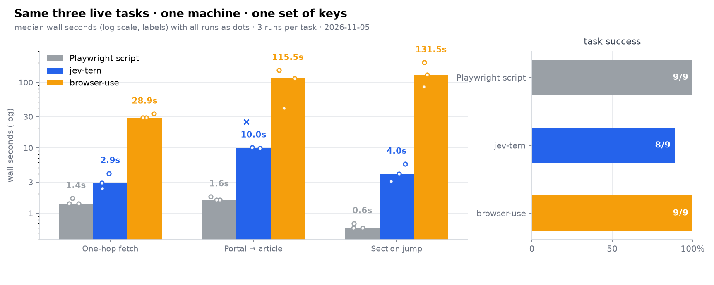

# Benchmark

Three live Wikipedia tasks, three contenders, three runs each, one machine, one set of API
keys. Every figure below is a measured run; medians are over successful runs and say so.



## Conclusions

1. **Speed: 18–73× over browser-use.** Wall-time medians — one-hop fetch 1.6 s vs 28.9 s
   (**18.1×**), portal search 3.4 s vs 115.5 s (**34.0×**), section jump 1.8 s vs 131.5 s
   (**73.1×**); geometric mean **≈35×** across the suite.
2. **Success: 9/9 for all three contenders.** Every jev-tern run met its criterion,
   with the portal runs verified externally by URL (3/3 on the day's article).
3. **The hand-written script set the floor: 1.4 / 1.6 / 0.6 s medians**, now 1.1–3.0×
   under jev-tern. The script knows each page's DOM in advance — a human picked its
   selectors by inspecting the page. jev-tern reads every page for the first time,
   matches that floor within one order of magnitude everywhere, takes plain language,
   and reports honest `budget` / `blocked` on the runs that go sideways.

## Contenders

| Contender | What it is | Brain |
|---|---|---|
| **jev-tern** (this repo) | agent loop on Tern's picture-in-picture WebKit tab | TypeSafe Jev `jev-1.14.0` judges each step; GLM-5.3-Flash types values |
| [browser-use](https://github.com/browser-use/browser-use) v0.11.13 | agent loop on headless Playwright Chromium | GLM-5.3 via bigmodel, same key family |
| Playwright script | hand-written deterministic script per task | plain code |

Fairness notes: browser-use ran with the strongest model available on the same bigmodel
key (GLM-5.3). Its usual OpenAI/Anthropic models need a different key and stayed out of
this comparison. jev-tern kept its own judge (TypeSafe Jev) because that is the engine
under test. The Playwright script is the floor case: the fastest possible run, at the cost
of a human writing each task by hand.

## Tasks

| id | task | success criterion |
|---|---|---|
| t1-fetch | open the Mona Lisa article, confirm the artist | article open, artist name present |
| t2-portal | from the Main Page, open today's featured article | final page is the day's article (the archive page counts as a miss) |
| t3-section | bring the References heading into view | heading visible in the viewport |

## Results

| Task (median wall, range) | jev-tern | browser-use | Playwright script |
|---|---|---|---|
| t1-fetch | **1.6 s** (1.6–1.8) | 28.9 s (28.8–33.3) | 1.4 s (1.4–1.9) |
| t2-portal | **3.4 s** (3.3–3.8) | 115.5 s (40.5–154.1) | 1.6 s (1.6–1.8) |
| t3-section | **1.8 s** (1.7–1.8) | 131.5 s (86.7–202.1) | 0.6 s (0.6–0.7) |
| success | **9/9** | 9/9 | 9/9 |

Raw rows: [`bench/RESULTS.json`](bench/RESULTS.json).

## Environment and method

- Apple silicon macOS. jev-tern on Tern's picture-in-picture WebKit; browser-use and the
  script on Playwright Chromium 156 (build 1248), headless.

- Wall time covers the whole task (jev-tern's loop starts after its fixed ~1.6 s load
  wait; both are included in wall time).
- Success: jev-tern runs count as success when the engine reports `done`; on the portal
  task the final URL is additionally verified externally by the same check browser-use
  gets (article path, archive and Main Page count as misses). browser-use is judged by
  its final result and page history; the script, by the criterion checked in code.
- Judgment round-trip inside jev-tern runs: 250–400 ms per step. An 8-step run consumed
  44,371 input / 4,393 output tokens (≈5.5 k in / 550 out per step, snapshot included).

## Reproduce

```bash
cd bench
npm install                                  # playwright for the baseline
node playwright-baseline.mjs                 # 9 rows
uv venv && uv pip install "browser-use==0.11.13" "playwright==1.64.*"
.venv/bin/python browser-use-task.py         # 9 rows
# then run the jev-tern side inside an OMP eval: bench/run-jevtern.snippet.js
uv run --with matplotlib make_chart.py       # writes docs/bench-chart.png
```

Set `BU_BROWSER_PATH` if browser-use cannot find your Chromium; `BU_MODEL` and
`BU_BASE_URL` override its brain.

## Defects these runs exposed in jev-tern (and their fixes)

1. **Restored scroll offset.** Reusing the tab restored the previous scroll position, so
   an answer task could start mid-article and burn its budget scrolling back. Fix: every
   task now starts from a fresh top-of-page viewport.
2. **Dead scroll options.** At the page top, `scroll_up` stayed on offer and was picked
   seven times in a row. Fix: directions that cannot move are removed before the judge
   sees the action list.
3. **Section shortcut on answer tasks.** A task mentioning the page title was dragged to
   a same-named section away from the lead that answered it. Fix: section shortcuts fire
   only for navigation-style tasks ("section", "heading", "跳到", …).
4. **Goal under-read on arrival.** The judge scored the correctly opened article 0.05–0.16
   because the page's own text never restated the task's wording, and the follow-up
   hedging (BACK, re-clicks) burned the budget. Fixes: the goal rules now credit the
   evidence chain explicitly (a portal naming the target plus a click opening it scores
   0.9+), and a fresh arrival reading 0.8+ with a low stuck signal finishes the task.
   Portal runs went from 2/3 at ~10 s to 3/3 at ~3.4 s, URL-verified.
5. **Recovery cost of a wrong click.** One wrong navigation used to cost the remaining
   budget. Fixes: a GO_BACK control appears whenever a previous distinct page exists, and
   deterministic shortcuts wait for one judgment step on a freshly navigated page before
   firing.
6. **Fixed readiness wait.** A flat 1.6 s post-load wait preceded every task. Fix: 0.5 s
   silence plus a `document.readyState` poll at 200 ms — one-hop fetch wall time dropped
   from ~2.9 s to ~1.6 s.
7. **Section-target hunting.** Bringing a named section into view burned six scroll
   steps plus judgment, and one run spent its whole budget oscillating between scroll
   directions. Fixes: a task naming a section in quotes gets a direct jump when the DOM
   holds exactly one such heading (the target exists before it scrolls into view), and
   after the jump the engine measures the heading's geometry and hands the fact to the
   judge as `code_verified` ground truth. Section runs went from 4.0–7.3 s with a flake
   to 1.7–1.8 s, 3/3.
8. **Finish confidence.** A DONE now needs three kinds of agreement: the operation
   choice DONE, the goal Noul at 0.8+, and the judge's own confidence at 0.6+; an action
   chosen below 0.55 confidence attaches a viewport screenshot to the next judgment as
   extra evidence.

## Note after these measurements

The runs above used click-settle that watched only the tab title, which waits out its
full window on single-page apps. A later change (settle polling the page signature and
returning on two stable reads) only shortens waits; the recorded numbers predate it and
are therefore conservative for jev-tern. The Rosetta Stone search flow that took
13–16 s before the change finishes in about 10 s after it, and the Google Flights run
in the README went from ~50 s to 24.6 s.
