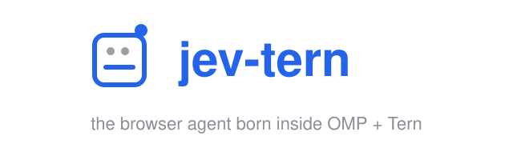
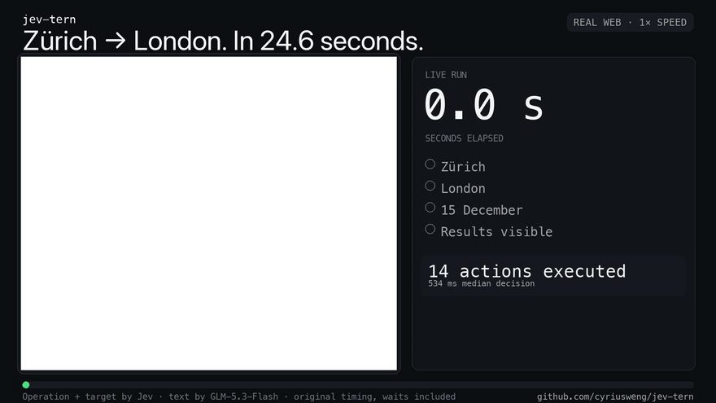
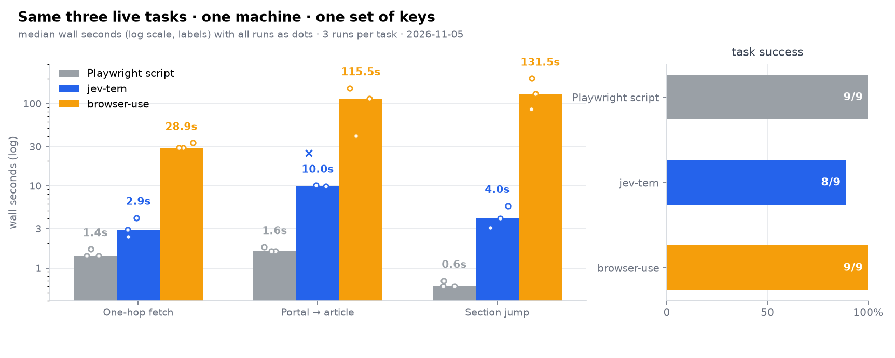

<div align="center">



**A browser agent you can watch.**

Type one sentence; it does the rest in a live browser tab.

[](LICENSE)
[](https://github.com/cyriusweng/jev-tern/stargazers)


[Benchmark](BENCHMARK.md) · [Quickstart](#quickstart) · [Running it elsewhere](#running-it-elsewhere) · [Licence](#licence-and-credits)

</div>

---

jev-tern finishes plain-language web tasks — click, type, select, close popups, jump to
sections, click canvas UI — in a browser tab you can watch the whole time. When a task
finishes, you get the status and the evidence behind it. When it fails, you get the
reason it failed.

**Zürich → London on Google Flights in 24.6 seconds**, one sentence in, every wait
included, the result independently verified after the run (autoplaying preview; the
full 1×-speed video with the live checklist is [docs/flights.mp4](docs/flights.mp4)):

<a href="docs/flights.mp4"></a>

Three live Wikipedia tasks, three runs each, same machine and same API keys for both
agents: jev-tern finished in 1.6, 3.4 and 1.8 seconds where
[browser-use](https://github.com/browser-use/browser-use) took 28.9, 115.5 and 131.5 —
between 18 and 73 times — with both agents at 9/9 success. A hand-written Playwright
script (0.6–1.6 s) shows what knowing the page in advance buys. Method, raw data and
chart: **[BENCHMARK.md](BENCHMARK.md)**. A recorded race on one task — jev-tern side
by side with browser-use, real time — is in [docs/race.mp4](docs/race.mp4).



## How it works

Each step makes exactly one request to a Jev judge: which operation, which target, is the
goal met. Everything a computer can measure — page readiness, scroll positions, section
geometry, exact task-text matches, image sizing — runs in code, and the engine hands the
measured facts to the judge as `code_verified`. Field values come from any
OpenAI-compatible chat endpoint.

The engine was built for the OMP + Tern desktop setup, where it drives the
picture-in-picture WebKit tab. It talks to the browser through six calls, so it runs on
any stack that provides them.

## Quickstart

Needs Node ≥ 18 and two keys in the environment: `TYPESAFE_KEY` for the
[Jev](https://typesafe.ai) judge, and `TYPING_BASE_URL` + `TYPING_MODEL` + `TYPING_KEY`
for any OpenAI-compatible chat endpoint that fills form fields.

```sh
git clone https://github.com/cyriusweng/jev-tern && cd jev-tern
npm install && npx playwright install chromium
node run.mjs "In Wikipedia search, find the article about the Rosetta Stone and open it" \
  https://en.wikipedia.org/wiki/Main_Page
```

A Chromium window opens, the task runs step by step in it, and the result prints to the
terminal. `--headless` runs it invisibly, `--json` prints machine-readable output,
`--markdown` returns the final page as markdown, `--cdp <url>` attaches to a browser you
already have running. As a library:

```js
import { attachCdpBridge } from "./cdp-bridge.mjs";
await attachCdpBridge();            // sets globalThis.browser
const jt = await import("./jevTern.mjs");
const r = await jt.run({ task: "…", startUrl: "https://…" });
```

The result carries `status` (`done | blocked | stuck | budget | error`), `goal` (0–1
probability every requirement is met), per-step evidence in `steps`, and `markdown` when
asked for. Calls on one tab are sequential; keep two runs on the same tab out of
`Promise.all`.

## Running it elsewhere

The browser bridge is six calls. Implement these and the rest of the file runs as-is:

| Bridge call | Used for |
|---|---|
| `browser.open({name, url, wait_until})` | open or reuse a tab, returns the tab handle |
| `tab.evaluate(js)` | run JS in the page, get a JSON value back (snapshot, actions, markdown) |
| `tab.clickAt(x, y)` | native click at viewport coordinates (the canvas path) |
| `tab.title()` | watch navigation settle between steps |
| `tab.allowedDomains([…])` | optional domain guard |
| `tab.run(async ({page}) => …)` | full page access, used only for screenshots |

Keys are the ones from Quickstart; a local credential store works as a fallback when the
environment variables are unset (point `OMP_BIN` at it). The engine was born on the
OMP + Tern desktop setup, where it drives the picture-in-picture WebKit tab through the
same six calls.

## What it handles

- Click, type, select, scroll, and jumps to section headings; a task naming a section in
  quotes jumps directly when the DOM holds exactly one such heading, then hands the
  measured geometry to the judge as code-verified fact.
- Popups: shadow DOM is pierced (consent banners become ordinary buttons), overlays are
  detected mechanically, dismissing them is a normal click.
- Canvas pages: a page with almost nothing in the DOM gets a viewport screenshot, a Box
  question finds the right control, and the returned coordinates are clicked natively —
  measured 3 px off a drawn circle.
- Fetch-style tasks: `markdown: true` returns the final page's main content as markdown
  (headings, paragraphs, lists, links, tables; 20k cap; navigation and citation noise
  removed).
- Shortcuts: a task naming a unique select option or link executes in code without a model
  round, and never twice in a row; shortcuts wait for one judgment step on a freshly
  navigated page.
- Recovery: a GO_BACK control appears whenever a previous distinct page exists, so a
  wrong navigation costs one step.
- Confidence floors: a DONE needs the operation choice, the goal at 0.8+, and the judge's
  own confidence at 0.6+; an action picked below 0.55 attaches a viewport screenshot to
  the next judgment.
- Every task starts from a fresh top-of-page viewport, and scroll directions that cannot
  move are withheld from the judge.

## Limits

- The snapshot reads the top frame; iframe content stays out of view.
- Logged-out by design: login walls end as `blocked` with the wall described.
- Image questions follow TypeSafe's preview-grade pipeline and may shift between releases.
- Each screenshot costs about 4k input tokens; the engine attaches one only when pixels
  add signal: DOM-thin pages, overlays, two actions in a row that changed nothing, or a
  low-confidence action.

## Licence and credits

MIT. The snapshot and rules text are ports from the MIT-licensed browser-use /
jev-ultrafast projects. Judgments use Jev from TypeSafe AI.
